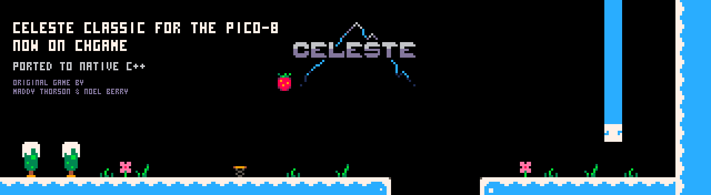
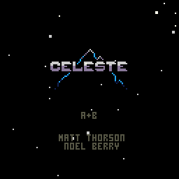

<a id="readme-top"></a>

<div align="center">

<a href="https://github.com/bateske/CHeleste">
  
</a>

<h3>Celeste Classic for the CHGame handheld, rewritten in native C++</h3>

<p>
  Maddy Thorson and Noel Berry's PICO-8 platformer, frame for frame.<br>
  No Lua interpreter: the cart's Lua ported by hand and proven against the original, every frame, in every room.
</p>

[![Stars][stars-shield]][stars-url] [![Issues][issues-shield]][issues-url] [![MIT License][license-shield]][license-url]

[![Platform][platform-shield]][chgame-url] [![Frame rate][fps-shield]](#how-it-works) [![Faithful][trace-shield]](#how-it-was-checked) [![Flash][flash-shield]](#how-it-works) [![RAM][ram-shield]](#how-it-works)

<p>
  <a href="https://github.com/bateske/CHeleste/releases/latest"><strong>Download the game »</strong></a>
  <br>
  <br>
  <a href="Cheleste/README.md">How to play</a>
  ·
  <a href="docs/pico8-to-chgame.md">From PICO-8 to CHGame</a>
  ·
  <a href="BUILDING.md">Building it</a>
  ·
  <a href="https://github.com/bateske/CHeleste/issues/new?labels=bug">Report a bug</a>
</p>

</div>

<details>
  <summary><strong>Table of contents</strong></summary>
  <ol>
    <li><a href="#about-the-game">About the game</a>
      <ul>
        <li><a href="#controls">Controls</a></li>
        <li><a href="#features">Features</a></li>
        <li><a href="#built-with">Built with</a></li>
      </ul>
    </li>
    <li><a href="#getting-started">Getting started</a></li>
    <li><a href="#how-it-works">How it works</a></li>
    <li><a href="#how-it-was-checked">How it was checked</a></li>
    <li><a href="#license">License</a></li>
    <li><a href="#acknowledgments">Acknowledgments</a></li>
  </ol>
</details>

## About the game

Climb Celeste Mountain, 100 m at a time. Run, jump, wall-jump and dash through 30 single-screen rooms of spikes, crumbling floors, springs, balloons and hidden strawberries, then plant your flag on the summit.

Celeste Classic was made in four days for PICO-8 in 2015, and grew into *Celeste*. The CHGame has the same 128x128, 16-colour screen as PICO-8, so the sprites, map and sound come straight out of the original cart. The Lua was rewritten in C++ for a 48 MHz RISC-V with 20 KB of RAM and no FPU.

<div align="center">
  
</div>

### Controls

| Button | Action |
|---|---|
| D-pad | Run; with B, the dash's direction (eight ways); DOWN crouches, UP looks up |
| A | Jump; next to a wall, wall-jump |
| B | Dash: one in the air, two after the orb. A dash breaks cracked walls |
| START | Pause: continue, restart the room, or back to the title |

The rules and what is in the mountain are in the game's own
[README](Cheleste/README.md).

### Features

- **The original game, frame for frame.** Physics, rooms, timings and quirks are the cart's, down to PICO-8's 16.16 number rounding.
- **The original art and map**, extracted from the cart at build time: all 31 rooms, the title, the summit.
- **Its music and sound effects on the piezo.** 21 effects and the area songs, converted from the cart's `__sfx__` and `__music__`.
- **30 fps on the board**, with about half of each frame to spare.
- **Pause and continue**, which the cart never had. START pauses the climb; each new level is saved, and the title offers to continue from it.
- **A complete scripted playthrough**, boot to summit in 1:53 with no deaths, that runs in CHGame's simulator as a test.

### Built with

[![C++][cpp-shield]][cpp-url] [![Arduino][arduino-shield]][arduino-url] [![RISC-V][riscv-shield]][riscv-url] [![Python][python-shield]][python-url] [![Lua][lua-shield]][lua-url] [![Zig][zig-shield]][zig-url]

The [CHGame][chgame-url] library and CHGfx; Python for the cart extractors; Lua 5.4 (via lupa) to run the original cart on the PC for the comparisons; and CHGame's simulator.

<p align="right">(<a href="#readme-top">back to top</a>)</p>

## Getting started

1. Download the latest release from the
   [Releases](https://github.com/bateske/CHeleste/releases/latest) page.
2. Pick one:
   - **The cart**, `CHeleste-<version>.chgame`, for CHGame's SD menu and tools.
   - **The firmware**, `CHeleste-<version>.bin`, to upload over USB without building it.
3. Pick Celeste Classic from the menu and press A.

To build it yourself, or to regenerate its data from your own copy of the cart, see [BUILDING.md](BUILDING.md).

<p align="right">(<a href="#readme-top">back to top</a>)</p>

## How it works

```
assets/celeste.p8 ──► tools/p8extract.py ──► src/assets/Cart.*   sprites, map, flags, palette
                  └─► tools/p8audio.py   ──► src/audio/Audio.*   effects, Playtune songs
cart's __lua__    ──► (by hand)          ──► Cheleste/Game.cpp   the game, function by function
```

- **[Game.cpp](Cheleste/Game.cpp)** is the cart's Lua, in its order and with its names. It knows nothing of CHGame: it draws through [P8.cpp](Cheleste/P8.cpp), which reimplements PICO-8's drawing calls on the framebuffer.
- **[Fix.h](Cheleste/Fix.h)** gives the game PICO-8's numbers: 16.16 fixed point, with wrapping, flooring and PICO-8's `%`. No floating point reaches the chip.
- **The sprite sheet** is stored the way the framebuffer packs pixels, so a sprite row is four bytes copied with a transparency test.

| At a glance | |
|---|---|
| Frame rate | the cart's 30 fps; rendering is estimated at 13-19 ms of the 33 ms frame |
| Flash | 45,448 of 50,432 B (both save pages kept) |
| RAM | 17,360 of 18,416 B, plus a 2 KB stack |
| Data from the cart | 12 KB of sheet and map, about 9 KB of sound |
| Objects | a fixed pool of 40; the busiest room uses 25 |

<p align="right">(<a href="#readme-top">back to top</a>)</p>

## How it was checked

The port is checked against the cart itself, not against a description of it:

- **Golden traces.** [tools/ref/compare.py](tools/ref/compare.py) runs the cart's own Lua on the PC next to `Game.cpp`, on the same button presses. Every object, sound, death and room change is compared every frame. Across 128 runs of 900 frames, covering the title and every room, all of them agree.
- **The community's TAS.** Replayed level by level, 29 of 30 levels clear on the very same frame as the original.
- **The whole game.** [tools/ref/playthrough.py](tools/ref/playthrough.py) chains the TAS from boot to summit on the board's own numbers. The result is a simulator script that `./cl check` plays through, with a picture of every level.

How this was done, and what to reuse to port the next PICO-8 cart, is in **[docs/pico8-to-chgame.md](docs/pico8-to-chgame.md)**.

<p align="right">(<a href="#readme-top">back to top</a>)</p>

## License

The code, tools and documentation of the port are under the MIT licence: see [LICENSE](LICENSE). The CHGame code under `chgame/` keeps its own licences (`chgame/NOTICE`, `chgame/LICENSE`).

Celeste Classic's game design, sprites, map, music and sound effects are Maddy Thorson and Noel Berry's, and are not covered by any licence here. The data generated from the cart is in `Cheleste/src/assets` and `Cheleste/src/audio`. The original cart is not in the repository. See [Cheleste/NOTICE](Cheleste/NOTICE).

<p align="right">(<a href="#readme-top">back to top</a>)</p>

## Acknowledgments

- **Maddy Thorson and Noel Berry**, for [Celeste Classic](https://www.lexaloffle.com/bbs/?tid=2145) and for *Celeste*.
- **Noel Berry**'s [C# version](https://github.com/NoelFB/Celeste) of the game (MIT), read alongside the cart.
- **[zepto8](https://github.com/samhocevar/zepto8)** (Sam Hocevar), whose PICO-8 BIOS shows how `foreach` really behaves.
- **[ClassicTAS](https://github.com/CelesteClassic/ClassicTAS)**, whose Any% TAS is the route the tests play.
- **[Lexaloffle](https://www.lexaloffle.com/pico-8.php)**, for PICO-8.

<p align="right">(<a href="#readme-top">back to top</a>)</p>

<!-- MARKDOWN LINKS & IMAGES -->
[release-url]: https://github.com/bateske/CHeleste/releases/latest
[stars-shield]: https://img.shields.io/github/stars/bateske/CHeleste?style=for-the-badge&color=29adff
[stars-url]: https://github.com/bateske/CHeleste/stargazers
[issues-shield]: https://img.shields.io/github/issues/bateske/CHeleste?style=for-the-badge&color=29adff
[issues-url]: https://github.com/bateske/CHeleste/issues
[license-shield]: https://img.shields.io/badge/code-MIT-1d2b53?style=for-the-badge
[license-url]: https://github.com/bateske/CHeleste/blob/main/LICENSE
[platform-shield]: https://img.shields.io/badge/platform-CHGame%20handheld-7e2553?style=for-the-badge
[fps-shield]: https://img.shields.io/badge/the%20cart's-30%20fps-7e2553?style=for-the-badge
[trace-shield]: https://img.shields.io/badge/vs%20the%20original%20Lua-every%20frame-008751?style=for-the-badge
[flash-shield]: https://img.shields.io/badge/flash-45%2C448%20%2F%2050%2C432%20B-5f574f?style=for-the-badge
[ram-shield]: https://img.shields.io/badge/RAM-17%2C360%20%2F%2018%2C416%20B-5f574f?style=for-the-badge
[chgame-url]: https://github.com/bateske/CHGame
[cpp-shield]: https://img.shields.io/badge/C++-00599C?style=for-the-badge&logo=cplusplus&logoColor=white
[cpp-url]: https://isocpp.org/
[arduino-shield]: https://img.shields.io/badge/Arduino-00878F?style=for-the-badge&logo=arduino&logoColor=white
[arduino-url]: https://arduino.github.io/arduino-cli/
[riscv-shield]: https://img.shields.io/badge/RISC--V-283272?style=for-the-badge&logo=riscv&logoColor=white
[riscv-url]: https://riscv.org/
[python-shield]: https://img.shields.io/badge/Python-3776AB?style=for-the-badge&logo=python&logoColor=white
[python-url]: https://www.python.org/
[lua-shield]: https://img.shields.io/badge/Lua-2C2D72?style=for-the-badge&logo=lua&logoColor=white
[lua-url]: https://www.lua.org/
[zig-shield]: https://img.shields.io/badge/Zig%20cc-F7A41D?style=for-the-badge&logo=zig&logoColor=black
[zig-url]: https://ziglang.org/
